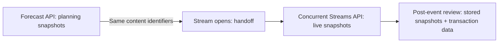

# Live Event Ad Playbook (LEAP): Multiple API Guidance

## Planning and Real-Time Adjustment

**Document status:** Draft implementation guidance for the LEAP 1.0 public-comment API designs. All events, stream counts, dates, region mappings, transaction assumptions, and commercial decisions are illustrative. This guidance does not establish new API fields or mandatory polling schedules.

**Companion documents:** [Common API Guidance](Common_API_Guidance.md), [Forecast API Guidance](Forecast_API_Guidance.md), [Concurrent Streams API Guidance](Concurrent_Streams_API_Guidance.md). The corresponding [Forecast API specification](../Forecast_API.md) and [Concurrent Streams API specification](../Concurrent_Streams_API.md) control if this guide conflicts with them.

> **Important:** Forecast and Concurrent Streams APIs communicate future estimates and current stream counts, **not guaranteed available advertising impressions, programmatic access, deal eligibility, bid-request counts, or ad-break timing**. Buyers and technology platforms must apply their own contractual, routing, targeting, fill, and monetization assumptions. The separate v1.1 proposal tracker is not part of LEAP 1.0 guidance.

## Purpose and intended audience

This walkthrough shows how a publisher or data provider, ad server/SSAI platform, SSP/exchange, and buyer/DSP might use two *pull-based* APIs to plan, scale, pace, and review a single fictional live event. A DSP's decisions span many campaigns, partners, supply paths, and infrastructure regions; this is **not** a prescribed campaign-optimization algorithm for one advertiser.

- **Forecast API, before the event:** discover upcoming programming and monitor event schedule, forecast concurrent streams, and anticipated pod/ad duration. Use estimates to allocate budget based on expected traffic, prepare request-processing capacity, and discuss deals without assuming any stream is programmatically accessible.
- **Concurrent Streams API, while the stream is open:** observe time-stamped concurrent SSAI and CSAI stream counts, prepare for request bursts, adjust throughput throttles and pacing, and detect unusually large regional or overall deviations.
- **After the event:** compare saved snapshots with realized bids, fills, delivery, and operational metrics from other systems; neither LEAP API reports those transactional outcomes.

## How the APIs connect



The operational handoff is **when the provider starts returning current stream counts for the event**, which can precede `scheduledstart` when pre-show programming is live. The event-level Forecast `eventstatus` indicates *scheduled/tentative/cancelled*, not the current live-playback state. A forecast remains a useful benchmark after handoff, but is not a current-stream measurement. In v1.0 the Concurrent Streams response has no explicit per-event live/ended status. If the event later disappears from a successful response, confirm event closure separately where accuracy matters; a missing event alone may reflect filtering, access or data problems.

## Cross-API identity correlation

The worked example uses exactly the same `content.id` — `event-content-12345` — in both APIs. `content.data.cids` offers additional shared identifiers (illustratively `shared-content-id-12345`). The Forecast event-level `id` is aligned as well. The same content identifier should be used in relevant OpenRTB content contexts wherever feasible.

For robust joins, record the provider identity along with content identifiers; `content.id` values may not be globally unique across independent providers. Avoid relying on titles or timing alone, particularly when an event is postponed, extended, or renamed. If no stable identifier exists, use documented provider-specific fallback logic and flag a possible mismatch for reconciliation.

## Worked example and conventions

The example follows a fictional **Championship Final, Game 7** scheduled for **8 November 2026, 01:00–05:00 UTC**. The stream opens for pre-show at 00:30 UTC, runs overtime beyond the published `scheduledend`, and continues into wind-down before it closes.

- Forecast `expectedpeak` and `lowerbound` are country-level **estimates**. The specification does not promise when the peak occurs or how many streams are ad-eligible.
- For v1.0 Concurrent Streams, `region` is an integer with a mapping that must be understood by participants. In this example, codes **1** and **2** represent two traffic regions within the forecasted country; they are not a newly standardized geographic taxonomy.
- `sstreams` and `cstreams` are SSAI and CSAI concurrent streams. SGAI follows the spec's SSAI category. These are not ad-request counts or unique users. The illustrative total adds SSAI and CSAI counts **assuming non-overlapping populations and consistent regional attribution**; implementations should confirm counting and de-duplication semantics with the data provider.
- The HTTP `GET` routes and time-window query parameters shown below illustrate the retrieval implementation. The current v1.0 object specifications do **not** define every transport/query detail as a mandatory interoperable contract; providers and consumers must agree on supported parameters.
- OAuth bearer credentials, ETag/`If-None-Match`, `Cache-Control`, and `304` are **illustrative optional HTTP techniques**, not newly mandated 1.0 wire fields. For an ETag conditional request, retain the **same representation URL** between polls; do not combine an ETag from a prior URL with a changed `lastmodifieddate` filter and assume 304 semantics. A provider can alternatively offer a negotiated modified-since filtering pattern.
- Suggested polling frequency is non-normative and subject to provider capacity, contractual authorization, rate limits, jitter and cache freshness.

## Illustrative request sequence

| Call | UTC / relative time | API | Main change |
|---:|---|---|---|
| 1 | Oct 9 · T-30 days | Forecast | Tentative; first audience range |
| 2 | Oct 25 · T-14 days | Forecast | Not modified (optional conditional GET) |
| 3 | Nov 1 · T-7 days | Forecast | Event scheduled; peak and lower estimate increase |
| 4 | Nov 7 · T-24 hours | Forecast | 11 pods; higher forecast and ad duration |
| 5 | Nov 8 00:30 · stream open | Concurrent Streams | 400,000 live streams |
| 6 | Nov 8 01:00 · event start | Concurrent Streams | 1.1 million live streams |
| 7 | Nov 8 01:40 · early event | Concurrent Streams | 1.4 million live streams |
| 8 | Nov 8 02:45 · intermission | Concurrent Streams | 1.9 million live streams |
| 9 | Nov 8 05:08 · overtime | Concurrent Streams | 2.4 million; event beyond planned end |
| 10 | Nov 8 05:35 · wind-down | Concurrent Streams | 600,000; stream remains open |
| 11 | Nov 8 05:50 · stream closed | Concurrent Streams | Event no longer returned; confirm end state |

## Call 1 — T-30 days: discover a tentative event

**When and why:** Oct 9; a daily pre-event poll discovers a potential event and its preliminary scale. The negotiated example request asks about a two-week window containing Nov 8.

```http
GET /v1/eventforecasts?scheduledstart=1793577600000&scheduledend=1794700800000
Authorization: Bearer {access_token}
Accept: application/json
```

```http
HTTP/1.1 200 OK
Content-Type: application/json
ETag: "fc-7b21"
Cache-Control: max-age=3600
```

```json
{
  "version": "1.0.0",
  "timestamp": 1791507600000,
  "events": [
    {
      "id": "event-content-12345",
      "scheduledstart": 1794099600000,
      "scheduledend": 1794114000000,
      "flexibleend": 1,
      "eventstatus": 2,
      "content": {
        "id": "event-content-12345",
        "title": "Championship Final, Game 7",
        "series": "Generic Sports Series",
        "channel": {
          "id": "ch-204",
          "name": "Sports 2"
        },
        "realtime": 1,
        "data": {
          "name": "id-provider.example",
          "cids": [
            "shared-content-id-12345"
          ]
        }
      },
      "streamsdata": [
        {
          "country": "USA",
          "expectedpeak": 1400000,
          "lowerbound": 700000
        }
      ],
      "inventoryconfig": {
        "supportedmtype": [
          2
        ],
        "totaladdurationsec": 1200,
        "expectedpodcount": 10,
        "unplanned": 1
      },
      "lastmodifieddate": 1791497700000
    }
  ]
}
```

**What changed:** First snapshot; `eventstatus = 2` means *tentative*. Expected peak is **1,400,000**, the reported lower estimate **700,000**, and the expected inventory includes **10 pods / 1,200 total ad seconds**, with `unplanned = 1`.

**Actions:** A DSP can model conditional budget allocation based on expected traffic across its event portfolio, not reserve a guaranteed number of impressions. An SSP can flag a potential capacity requirement; the publisher can discuss contingent packaging. Keep the snapshot for comparison.

## Call 2 — T-14 days: conditional poll; no change

**When and why:** Oct 25; around every 12 hours in this illustrative cadence. The client uses the unchanged collection URI and the ETag received in call 1.

```http
GET /v1/eventforecasts?scheduledstart=1793577600000&scheduledend=1794700800000
Authorization: Bearer {access_token}
Accept: application/json
If-None-Match: "fc-7b21"
```

```http
HTTP/1.1 304 Not Modified
ETag: "fc-7b21"
Cache-Control: max-age=3600
```

**Response body:** None (HTTP 304). The consumer reuses the call 1 representation. `304` depends on provider support for standard conditional HTTP semantics; it is not a distinct Forecast API response payload.

**What changed:** No change to the forecast; the event remains tentative. **Actions:** Retain the conditional plan and avoid unnecessary data transfer. If the provider does not implement ETags, a normal 200 response is acceptable; negotiated changed-since filters may be another strategy. To detect cancellations reliably, preserve access to records marked `eventstatus = 3` rather than silently treating their disappearance as cancellation.

## Call 3 — T-7 days: tentative becomes scheduled

**When and why:** Nov 1; poll about every six hours as the fictional event approaches. The event's outcome is now known and the provider updates the forecast.

```http
GET /v1/eventforecasts?scheduledstart=1793577600000&scheduledend=1794700800000
Authorization: Bearer {access_token}
Accept: application/json
If-None-Match: "fc-7b21"
```

```http
HTTP/1.1 200 OK
Content-Type: application/json
ETag: "fc-9c40"
```

```json
{
  "version": "1.0.0",
  "timestamp": 1793494800000,
  "events": [
    {
      "id": "event-content-12345",
      "scheduledstart": 1794099600000,
      "scheduledend": 1794114000000,
      "flexibleend": 1,
      "eventstatus": 1,
      "content": {
        "id": "event-content-12345",
        "title": "Championship Final, Game 7",
        "series": "Generic Sports Series",
        "channel": {
          "id": "ch-204",
          "name": "Sports 2"
        },
        "realtime": 1,
        "data": {
          "name": "id-provider.example",
          "cids": [
            "shared-content-id-12345"
          ]
        }
      },
      "streamsdata": [
        {
          "country": "USA",
          "expectedpeak": 1800000,
          "lowerbound": 1200000
        }
      ],
      "inventoryconfig": {
        "supportedmtype": [
          2
        ],
        "totaladdurationsec": 1200,
        "expectedpodcount": 10,
        "unplanned": 1
      },
      "lastmodifieddate": 1793421600000
    }
  ]
}
```

| Field | Call 1 | Call 3 | Change |
|---|---:|---:|---|
| `eventstatus` | 2 tentative | 1 scheduled | Event confirmed |
| `expectedpeak` | 1,400,000 | 1,800,000 | +400,000 (+28.6%) |
| `lowerbound` | 700,000 | 1,200,000 | +500,000 (+71.4%) |
| Numerical span | 700,000 | 600,000 | Narrower estimate |

**Actions:** Buyers revisit cross-event budget allocation and campaign pacing assumptions based on the higher expected traffic; SSPs refine capacity planning; publishers can update deal discussions. A narrower numerical span does not itself provide a mathematically calibrated confidence level.

## Call 4 — T-24 hours: final planning baseline

**When and why:** Nov 7; poll hourly until stream opening in this example. Store the latest full forecast as the baseline for live comparisons.

```http
GET /v1/eventforecasts?scheduledstart=1793577600000&scheduledend=1794700800000
Authorization: Bearer {access_token}
Accept: application/json
If-None-Match: "fc-9c40"
```

```http
HTTP/1.1 200 OK
Content-Type: application/json
ETag: "fc-f108"
```

```json
{
  "version": "1.0.0",
  "timestamp": 1794013200000,
  "events": [
    {
      "id": "event-content-12345",
      "scheduledstart": 1794099600000,
      "scheduledend": 1794114000000,
      "flexibleend": 1,
      "eventstatus": 1,
      "content": {
        "id": "event-content-12345",
        "title": "Championship Final, Game 7",
        "series": "Generic Sports Series",
        "channel": {
          "id": "ch-204",
          "name": "Sports 2"
        },
        "realtime": 1,
        "data": {
          "name": "id-provider.example",
          "cids": [
            "shared-content-id-12345"
          ]
        }
      },
      "streamsdata": [
        {
          "country": "USA",
          "expectedpeak": 1900000,
          "lowerbound": 1400000
        }
      ],
      "inventoryconfig": {
        "supportedmtype": [
          2
        ],
        "totaladdurationsec": 1320,
        "expectedpodcount": 11,
        "unplanned": 1
      },
      "lastmodifieddate": 1793991900000
    }
  ]
}
```

| Field | Call 3 | Call 4 | Change |
|---|---:|---:|---|
| `expectedpeak` | 1,800,000 | 1,900,000 | +100,000 (+5.6%) |
| `lowerbound` | 1,200,000 | 1,400,000 | +200,000 (+16.7%) |
| `expectedpodcount` | 10 | 11 | +1 pod |
| `totaladdurationsec` | 1,200 | 1,320 | +120 seconds (+10%) |

**Operational planning calculation (not an API field or universal rule):** Under the simplifying assumption of **one ad-decision request per stream per break** with **1.9 million streams** reaching a break during **five seconds**, estimated ad-server intake is `1,900,000 / 5 = 380,000 requests/second`. Different request architectures, SSAI/CSAI distribution, eligibility, buffering, prefetch, fan-out, batching, timeouts, and traffic routing can materially change this number; an SSP or DSP's own QPS will differ.

**Actions:** DSPs and SSPs plan configurable capacity headroom and delivery controls. Ad servers consider prefetch and request-spreading mechanisms. **Do not** multiply average concurrency by pods and a presumed ads-per-pod to assert available impressions: the API does not say how many ad decisions, impressions, or bid opportunities are accessible to any individual partner. `1,320` represents the *forecast total ad duration*, not an offer of 1,320 programmatically available ad seconds.

## Call 5 — stream opens: handoff to live measurement

**When and why:** Nov 8 at 00:30 UTC, **30 minutes before `scheduledstart`**. The provider begins returning the event in the Concurrent Streams collection. Polling every five minutes during pre-show is an illustrative choice.

```http
GET /v1/concurrentstreams
Authorization: Bearer {access_token}
Accept: application/json
```

```http
HTTP/1.1 200 OK
Content-Type: application/json
Cache-Control: max-age=15
```

```json
{
  "version": "1.0.0",
  "timestamp": 1794097800000,
  "streamsdata": [
    {
      "sdp": "provider-1",
      "mediastreams": [
        {
          "content": {
            "id": "event-content-12345",
            "title": "Championship Final, Game 7",
            "series": "Generic Sports Series",
            "channel": {
              "id": "ch-204",
              "name": "Sports 2"
            },
            "realtime": 1,
            "data": {
              "name": "id-provider.example",
              "cids": [
                "shared-content-id-12345"
              ]
            }
          },
          "eventstart": 1794099600000,
          "eventend": 1794114000000,
          "streamcount": [
            {
              "region": 1,
              "sstreams": 220000,
              "cstreams": 80000
            },
            {
              "region": 2,
              "sstreams": 75000,
              "cstreams": 25000
            }
          ]
        }
      ]
    }
  ]
}
```

**Live count:** Region 1: 220,000 SSAI + 80,000 CSAI = **300,000**; region 2: 75,000 SSAI + 25,000 CSAI = **100,000**; total **400,000**. This is below an independently assumed pre-show planning baseline of 500,000 (which is **not** a Forecast API field).

**Actions:** Match `content.id` to the forecast and relevant bid-request metadata, establish live freshness/lag checks, and use the live count for operational decisions. A cache response directive such as `max-age=15` defines an upper cache freshness age in this example; it does **not** establish a mandatory server update interval or guarantee that newer snapshots exist. Avoid polling faster than useful signal freshness.

## Call 6 — event start: audience rapidly expands

**When and why:** Nov 8 at 01:00:30 UTC, immediately after scheduled event start. A 30–60 second poll is a possible operational cadence.

```http
GET /v1/concurrentstreams
Authorization: Bearer {access_token}
Accept: application/json
```

```http
HTTP/1.1 200 OK
Content-Type: application/json
```

```json
{
  "version": "1.0.0",
  "timestamp": 1794099630000,
  "streamsdata": [
    {
      "sdp": "provider-1",
      "mediastreams": [
        {
          "content": {
            "id": "event-content-12345",
            "title": "Championship Final, Game 7",
            "series": "Generic Sports Series",
            "channel": {
              "id": "ch-204",
              "name": "Sports 2"
            },
            "realtime": 1,
            "data": {
              "name": "id-provider.example",
              "cids": [
                "shared-content-id-12345"
              ]
            }
          },
          "eventstart": 1794099600000,
          "eventend": 1794114000000,
          "streamcount": [
            {
              "region": 1,
              "sstreams": 600000,
              "cstreams": 200000
            },
            {
              "region": 2,
              "sstreams": 230000,
              "cstreams": 70000
            }
          ]
        }
      ]
    }
  ]
}
```

**What changed:** Current total **1,100,000** streams; **+175% versus pre-show (2.75×)**. The `streamcount[]` entries reveal the regional SSAI/CSAI distribution.

**Actions:** DSPs monitor bid throttling and pacing against actual spend and wins; SSP/ad server participants ensure opening-break capacity and request spreading. The Concurrent Streams response does not give the first break time.

## Call 7 — early event: growth moderates

**When and why:** Nov 8 at 01:40 UTC; poll every 30–60 seconds where needed.

```http
GET /v1/concurrentstreams
Authorization: Bearer {access_token}
Accept: application/json
```

```http
HTTP/1.1 200 OK
Content-Type: application/json
```

```json
{
  "version": "1.0.0",
  "timestamp": 1794102000000,
  "streamsdata": [
    {
      "sdp": "provider-1",
      "mediastreams": [
        {
          "content": {
            "id": "event-content-12345",
            "title": "Championship Final, Game 7",
            "series": "Generic Sports Series",
            "channel": {
              "id": "ch-204",
              "name": "Sports 2"
            },
            "realtime": 1,
            "data": {
              "name": "id-provider.example",
              "cids": [
                "shared-content-id-12345"
              ]
            }
          },
          "eventstart": 1794099600000,
          "eventend": 1794114000000,
          "streamcount": [
            {
              "region": 1,
              "sstreams": 760000,
              "cstreams": 250000
            },
            {
              "region": 2,
              "sstreams": 300000,
              "cstreams": 90000
            }
          ]
        }
      ]
    }
  ]
}
```

**What changed:** Current total **1,400,000** streams; **+27% versus start; at the final forecast lower estimate**. The `streamcount[]` entries reveal the regional SSAI/CSAI distribution.

**Actions:** Buyers reassess pacing using remaining campaign budgets and actual outcomes; SSPs verify headroom for later breaks. An audience increase alone does not prove additional biddable supply.

## Call 8 — intermission: forecast peak reached

**When and why:** Nov 8 at 02:45 UTC; the illustrative polling cadence tightens to 15–30 seconds for a high-stress phase.

```http
GET /v1/concurrentstreams
Authorization: Bearer {access_token}
Accept: application/json
```

```http
HTTP/1.1 200 OK
Content-Type: application/json
```

```json
{
  "version": "1.0.0",
  "timestamp": 1794105900000,
  "streamsdata": [
    {
      "sdp": "provider-1",
      "mediastreams": [
        {
          "content": {
            "id": "event-content-12345",
            "title": "Championship Final, Game 7",
            "series": "Generic Sports Series",
            "channel": {
              "id": "ch-204",
              "name": "Sports 2"
            },
            "realtime": 1,
            "data": {
              "name": "id-provider.example",
              "cids": [
                "shared-content-id-12345"
              ]
            }
          },
          "eventstart": 1794099600000,
          "eventend": 1794114000000,
          "streamcount": [
            {
              "region": 1,
              "sstreams": 1030000,
              "cstreams": 330000
            },
            {
              "region": 2,
              "sstreams": 410000,
              "cstreams": 130000
            }
          ]
        }
      ]
    }
  ]
}
```

**What changed:** Current total **1,900,000** streams; **+36% versus early event; equals final `expectedpeak`**. The `streamcount[]` entries reveal the regional SSAI/CSAI distribution.

**Actions:** Ad servers/SSPs monitor throughput, timeouts, and supply-path fan-out; DSPs monitor actual bid traffic, deduplication indicators, win rates, and pacing rather than treating 1.9 million streams as bid opportunities.

**Separate transaction-data check (illustrative, not in either API):** Suppose a known six-slot break has **1.9 million participating streams**, which under the additional assumption of one unique opportunity per stream per slot suggests **at most 11.4 million modeled stream-slot opportunities**. If a DSP independently observes **14.8 million bid requests** carrying that event identifier, investigate duplicate paths, retries, request fan-out, different stream populations and counting rules. The ratio `14.8 / 11.4 ≈ 1.30` is a **diagnostic flag**, **not proof** that exactly 3.4 million requests (or 23%) were duplicates. The six slots and DSP request volumes come from outside the LEAP APIs.

## Call 9 — overtime: above the range, beyond scheduled end

**When and why:** Nov 8 at 05:08 UTC, eight minutes past scheduled end. The illustrative cadence is 15–30 seconds.

```http
GET /v1/concurrentstreams
Authorization: Bearer {access_token}
Accept: application/json
```

```http
HTTP/1.1 200 OK
Content-Type: application/json
```

```json
{
  "version": "1.0.0",
  "timestamp": 1794114480000,
  "streamsdata": [
    {
      "sdp": "provider-1",
      "mediastreams": [
        {
          "content": {
            "id": "event-content-12345",
            "title": "Championship Final, Game 7",
            "series": "Generic Sports Series",
            "channel": {
              "id": "ch-204",
              "name": "Sports 2"
            },
            "realtime": 1,
            "data": {
              "name": "id-provider.example",
              "cids": [
                "shared-content-id-12345"
              ]
            }
          },
          "eventstart": 1794099600000,
          "eventend": 1794115800000,
          "streamcount": [
            {
              "region": 1,
              "sstreams": 1500000,
              "cstreams": 400000
            },
            {
              "region": 2,
              "sstreams": 400000,
              "cstreams": 100000
            }
          ]
        }
      ]
    }
  ]
}
```

**What changed:** Current total **2,400,000** streams; **+26% versus intermission; 26.3% above final `expectedpeak`**. The `streamcount[]` entries reveal the regional SSAI/CSAI distribution.

**Actions:** Region 1 rises to 1.9 million while region 2 is 0.5 million. Providers and consumers maintain active stream processing beyond `scheduledend` when actual playback continues. An unplanned break may occur, but no 1.0 Concurrent Streams `adbreaks` field announces it.

**Overtime interpretation:** The earlier Forecast `flexibleend = 1` warned that the published end was not fixed. The provider's live `eventend` is now 05:30 UTC, later than the forecast `scheduledend` of 05:00 UTC. Treat active playback and fresh live snapshots as operationally more useful than the original end time, subject to provider reconciliation.

## Call 10 — wind-down: the audience declines

**When and why:** Nov 8 at 05:35 UTC; the live stream remains open for post-event coverage. Poll about every five minutes, if still operationally useful.

```http
GET /v1/concurrentstreams
Authorization: Bearer {access_token}
Accept: application/json
```

```http
HTTP/1.1 200 OK
Content-Type: application/json
```

```json
{
  "version": "1.0.0",
  "timestamp": 1794116100000,
  "streamsdata": [
    {
      "sdp": "provider-1",
      "mediastreams": [
        {
          "content": {
            "id": "event-content-12345",
            "title": "Championship Final, Game 7",
            "series": "Generic Sports Series",
            "channel": {
              "id": "ch-204",
              "name": "Sports 2"
            },
            "realtime": 1,
            "data": {
              "name": "id-provider.example",
              "cids": [
                "shared-content-id-12345"
              ]
            }
          },
          "eventstart": 1794099600000,
          "eventend": 1794115800000,
          "streamcount": [
            {
              "region": 1,
              "sstreams": 380000,
              "cstreams": 100000
            },
            {
              "region": 2,
              "sstreams": 90000,
              "cstreams": 30000
            }
          ]
        }
      ]
    }
  ]
}
```

**What changed:** Current total **600,000** streams; **−75% versus overtime**. The `streamcount[]` entries reveal the regional SSAI/CSAI distribution.

**Actions:** Reduce unnecessary excess capacity and adjust campaign pacing using actual inventory/delivery signals. Falling stream counts do not prove that no further ad breaks or monetization opportunities remain.

## Call 11 — stream closes: save and review

**When and why:** Nov 8 at 05:50 UTC; the provider returns no live media streams under the authorized provider collection. There is **no explicit per-event ended status in 1.0**.

```http
GET /v1/concurrentstreams
Authorization: Bearer {access_token}
Accept: application/json
```

```http
HTTP/1.1 200 OK
Content-Type: application/json
```

```json
{
  "version": "1.0.0",
  "timestamp": 1794117000000,
  "streamsdata": [
    {
      "sdp": "provider-1",
      "mediastreams": []
    }
  ]
}
```

**What changed:** The event is absent from this successful snapshot. This **can** indicate stream closure, but does not by itself distinguish closure from permissions, transient provider data gaps, feed filtering or a delayed snapshot. Confirm with provider/event operations or independent telemetry if an authoritative end state is required.

**Actions:** Save all snapshots and compare them with bidstream, ad server, SSAI, campaign, and reporting results. Do not infer delivered ads or revenue from stream counts alone.

## Cumulative snapshot tables

### Forecast snapshots

| Call | UTC | HTTP | `eventstatus` | `expectedpeak` | `lowerbound` | Forecast pods | Forecast ad seconds |
|---|---|---|---|---:|---:|---:|---:|
| 1 | Oct 9 | 200 | 2 tentative | 1,400,000 | 700,000 | 10 | 1,200 |
| 2 | Oct 25 | 304 (optional) | 2 tentative (cached) | 1,400,000 | 700,000 | 10 | 1,200 |
| 3 | Nov 1 | 200 | 1 scheduled | 1,800,000 | 1,200,000 | 10 | 1,200 |
| 4 | Nov 7 | 200 | 1 scheduled | 1,900,000 | 1,400,000 | 11 | 1,320 |

### Concurrent Streams snapshots

| Call | Time UTC | Region 1 SSAI | Region 1 CSAI | Region 2 SSAI | Region 2 CSAI | Total streams | vs. prior |
|---|---|---:|---:|---:|---:|---:|---:|
| 5 | 00:30 | 220,000 | 80,000 | 75,000 | 25,000 | 400,000 | — |
| 6 | 01:00 | 600,000 | 200,000 | 230,000 | 70,000 | 1,100,000 | +175% |
| 7 | 01:40 | 760,000 | 250,000 | 300,000 | 90,000 | 1,400,000 | +27% |
| 8 | 02:45 | 1,030,000 | 330,000 | 410,000 | 130,000 | 1,900,000 | +36% |
| 9 | 05:08 | 1,500,000 | 400,000 | 400,000 | 100,000 | 2,400,000 | +26% |
| 10 | 05:35 | 380,000 | 100,000 | 90,000 | 30,000 | 600,000 | −75% |
| 11 | 05:50 | — | — | — | — | Event absent | Confirm closure |

## Comparing the audience curve with the final forecast

The final Forecast API record reports a country-level estimate of **1.4 million lowerbound** and **1.9 million expectedpeak**. The table shows live snapshots plotted against these **event-level** values. The API does **not** supply a forecast for each phase; any pre-show, halftime, or other time-of-event baseline must come from independent planning assumptions, not from these fields.

| Live phase | Actual concurrent streams | Comparison to final `expectedpeak` |
|---|---:|---:|
| Stream opens | 400,000 | 21% |
| Event start | 1,100,000 | 58% |
| Early event | 1,400,000 | 74% |
| Intermission | 1,900,000 | 100% |
| Overtime | 2,400,000 | 126% |
| Wind-down | 600,000 | 32% |

The realized maximum in the sample is **2.4 million**, or approximately **26.3% above** the final expected peak. The upper forecast estimate was not guaranteed, and the lower estimate should not be interpreted as an absolute minimum concurrent stream count at every moment. Overtime illustrates why a `flexibleend = 1` event merits thoughtful spare capacity.

## Suggested polling and resilience (non-normative)

| API | Period | Illustrative poll interval | Why |
|---|---|---|---|
| Forecast | 30+ days before | Daily | Event discovery / conditional budgeting |
| Forecast | 14 days before | Every 12 hours | Detect revised forecasts and status |
| Forecast | 7 days before | Every 6 hours | Refine estimates / infrastructure plans |
| Forecast | 24 hours before | Hourly | Final baseline and capacity readiness |
| Concurrent Streams | Pre-show | Every 5 minutes | Identify start of live reporting |
| Concurrent Streams | During event | Every 30–60 seconds | Operational responsiveness |
| Concurrent Streams | High-traffic moments | Every 15–30 seconds | Manage rapid changes if provider permits |
| Concurrent Streams | Wind-down | Every 5 minutes | Adjust downward without overpolling |

Implementers should agree on authentication, permitted scopes, shared identifiers, provider snapshot refresh rates, acceptable age (`timestamp` versus receipt time), cache headers, client jitter, 429/`Retry-After`, and backoff during outages. Concurrent Streams collections can include **all live events** authorized for a consumer; v1.0 does not guarantee an `ids` event-filter parameter. Do not treat increased polling as a guarantee of lower-latency updates.

## Implementation safeguards and interpretation boundaries

- **Audience is not inventory:** concurrency is neither a guarantee of biddable impressions nor a disclosure of how much of an event is programmatically accessible. Deal terms, direct-sold allocations, impression eligibility, targeting, pod policy, and platform routing must be evaluated separately.
- **QPS is derived locally:** event concurrency, ad break timing, ad-decision architecture, request spread, and SSP/DSP fan-out collectively determine load. The APIs do not expose QPS directly.
- **Forecast ad load is not slots:** `expectedpodcount` and `totaladdurationsec` describe approximate structure/duration; creative lengths and ad decision patterns vary. Avoid multiplying by an assumed universal ads-per-pod value.
- **No live ad-break feed in v1.0:** Concurrent Streams signals current scale but not `next` break time, pods remaining, or ad seconds remaining. These require independent systems or future standardization.
- **Identity and freshness matter:** validate `content.id` and external cids with provider context, preserve timestamps, handle stale/missing responses, and avoid confusing no event record with confirmed completion.
- **Use independent outcomes for bidding decisions:** pacing, budget allocation, throttling, supply path quality, impression opportunity, and deduplication require bidstream and delivery telemetry in addition to concurrent-stream observations.
- **Preserve snapshots:** a post-event variance review should compare successive forecasts, peak live counts, timing, and separately measured transaction outcomes; do not extrapolate fills or revenue from either LEAP API.

## After the event: worked review

| Measure | Pre-event estimate / baseline | Observed | Interpretation |
|---|---|---|---|
| Expected peak concurrency | 1,900,000 | 2,400,000 | +26.3% above latest peak estimate |
| Lower estimate | 1,400,000 | Live reached and exceeded it | Not a minimum guarantee for every phase |
| Expected pods | 11 | 12 in illustrative operations log | Extra overtime pod **not reported** through v1.0 live API |
| Peak phase | Not signaled by Forecast API | Overtime | Timing cannot be inferred from event-level peak |
| DSP request volume at intermission | Not reported by either LEAP API | 14.8M in external bidstream example | Investigate paths against a separately modeled 11.4M stream-slot bound |

A useful review asks which planning assumptions were wrong, whether capacity held during the peak, and how much campaign delivery was actually accessible and won. None of the post-event pod or bid-request observations should be mislabeled as Concurrent Streams response fields.

## Potential changes outside the v1.0 scope

The constituent walkthrough contains a separate **“With proposed additions”** mode. That mode is intentionally **not** reproduced as current functionality here. A separate working-group **LEAP v1.1 proposal tracker** (not part of this published v1.0 guide) records its proposed forecast summary and per-event lookup, concurrent event-ID filtering and lifecycle status, regional taxonomy, ad-break detail, disclosure, and `flexend` rename for discussion **after** the 1.0 public-comment publication. None are endorsed or normative through this document.

